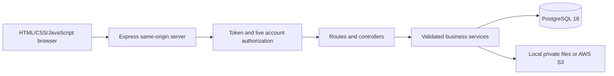
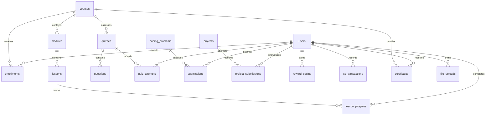

# Architecture and demonstration guide

## Request and data flow

Migrations retain the original `order_index`, `duration_minutes`, `attempted_at` and `submitted_at` fields. API aliases keep the frontend contract clear. New structures are additive. Transactions and unique reward claims prevent partially recorded milestones and concurrent double rewards.

## Demonstration sequence

1. Register/sign in as a student and inspect the dashboard.
2. Enroll in DSA, open a lesson, read notes and mark it complete.
3. Open a course quiz, submit answers, inspect the score and history.
4. Save a practice solution and inspect its stored status/history. Explain that it was not executed.
5. Submit a project repository/description and inspect actual portfolio evidence.
6. Complete the remaining course lessons and required quizzes; verify and print the course certificate.
7. Review badges, leaderboard, daily goals, bookmarks and recommendations.
8. Start a mock interview, compare sample answers and explicitly self-assess.
9. Upload/download a supported private file in Settings.
10. Sign in as a trusted administrator, create a draft course/module/lesson/quiz, publish it, and demonstrate archival with student history retained.

## Viva talking points

- Why relational enrollment, assessment and progress data fit PostgreSQL.
- Why code execution needs a separate isolation boundary and was excluded.
- How per-account transactions and reward claims handle concurrent requests.
- Why public course metadata and private account/evidence endpoints use different access rules.
- Why bcrypt input length is bounded and old hashes are migrated after authentication.
- How progress counts active lessons and certificates also require active quizzes.
- How a private S3 object differs from a public uploaded URL.
- Which cloud checks still need the owner's actual AWS deployment.

## Version control

From the project root, initialize a local repository if one is not already present, review `.gitignore`, run checks, commit the source and documentation, then connect the owner's chosen GitHub remote. Review the staged files before pushing. Do not commit `.env`, database dumps, uploaded files or `node_modules`. No remote is assumed or invented by this deliverable.
