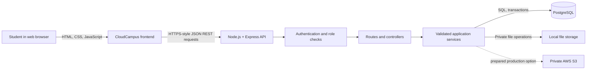

# CloudCampus — Project Progress and Technology Report

**Prepared:** 15 October 2026  
**Purpose:** Explain the current CloudCampus system, the software used to build it, its completed capabilities, and its remaining work for a project presentation or viva.

## 1. Project summary

CloudCampus is a browser-based learning management application for Computer Science students. It brings together course notes, assessments, coding practice, projects, interview preparation, student progress, and completion certificates in one place. The product's learning journey is **Learn → Practice → Track → Build → Prepare → Showcase**.

The current application uses a browser frontend, a Node.js and Express server, and a PostgreSQL database. The same server serves both the frontend and the API, so the browser talks to the app through one origin.

## 2. Main technologies and what each does

| Technology or tool | How CloudCampus uses it |
|---|---|
| **HTML5** | Provides the page structure, forms, navigation, course views, and accessible controls. |
| **CSS3** | Controls the responsive layout, branding, colors, typography, cards, and print layout for certificates. |
| **JavaScript (vanilla)** | Runs the frontend interactions and communicates with the API. The frontend does not use React or another UI framework. |
| **Node.js (20 or later)** | Runs the backend JavaScript application. The container definition uses Node 24. |
| **Express 5** | Hosts the web pages and defines the REST API routes and middleware. |
| **PostgreSQL 18** | Stores student accounts, courses, curriculum, assessments, attempts, progress, rewards, projects, certificates, and other relational data. |
| **`pg` (node-postgres)** | Connects the Node.js services to PostgreSQL and runs parameterized SQL queries and transactions. |
| **npm** | Installs the backend libraries and runs the start, development, database migration, seed, check, and test scripts. |
| **bcryptjs** | Hashes passwords before storage and checks passwords during sign-in. Existing supported legacy scrypt hashes can still be verified and upgraded after successful login. |
| **JWT** | Represents a signed student or administrator session for protected API calls. The browser stores the token in session storage. |
| **dotenv** | Loads private environment configuration for local development. Secrets belong in the private `.env` file and must not be committed. |
| **Helmet, CORS, express-rate-limit** | Add HTTP security headers, restrict cross-origin requests, and limit repeated requests. |
| **AWS SDK for JavaScript** | Supports prepared integrations with private S3 file storage and AWS Secrets Manager. This does not mean the application has been deployed to AWS. |
| **Docker** | A Dockerfile packages the frontend and backend into one container image for a future deployment. Docker runtime was not verified in the documented local review. |
| **AWS CloudFormation and PowerShell deployment scripts** | Describe and prepare the AWS deployment resources and steps. No AWS resources have been created for this project yet. |
| **Visual Studio Code and a web browser** | Used in the development workflow to edit the project and view the app. PostgreSQL is the database service; it is separate from VS Code. |

The backend libraries and minimum Node.js version are recorded in `backend/package.json`. Deployment preparation is described in `docs/AWS_DEPLOYMENT.md`.

## 3. How a request moves through the application



The frontend sends JSON requests to `/api/...`. Express routes select a controller; controllers validate and interpret the request; services apply the learning rules and use SQL to read or update PostgreSQL. Related updates such as lesson completion, XP, and streak changes are grouped into transactions so the records stay consistent if one operation fails.

The frontend is served by the same Express application as the API. This keeps the development setup simple and avoids a separate frontend server for the local demonstration.

## 4. Database and data model

PostgreSQL is a relational database. Related records are connected using primary keys and foreign keys. For example, a course contains modules; a module contains lessons; a student enrolls in a course; and a student's completion state is stored for each lesson.

Important record groups include:

- **Accounts and access:** users, roles/status, and sessions represented by signed tokens.
- **Curriculum:** courses, modules, lessons, enrollments, and lesson progress.
- **Assessments:** quizzes, questions, and quiz attempts with scores and percentages.
- **Practice:** coding problems and saved code submissions.
- **Projects and career prep:** guided projects, student project submissions, interview questions, and mock interview sessions.
- **Progress and recognition:** XP transactions, reward claims, streaks, achievements, and goals.
- **Student evidence:** bookmarks, notifications, portfolio details, file metadata, and certificates.

The main relationships can be summarized as:

```text
Student ── enrolls in ── Course ── contains ── Modules ── contain ── Lessons
   │                         │                                  │
   ├── records lesson progress                                  └── lesson notes/resources
   ├── attempts quizzes ── Quiz ── contains ── Questions
   ├── submits solutions ── Coding problems
   ├── submits work ── Guided projects
   ├── earns ── XP, achievements, streaks
   └── receives ── Course certificates
```

Database changes are applied as numbered SQL migrations in `backend/db/migrations`. Seed scripts add initial demo curriculum and content without treating the database as disposable. For an existing database, the project documentation says to apply migrations and not to restore `backend/db/schema.sql` over it. The schema export is intended for a new empty database.

## 5. Features implemented in the application

### Student learning journey

- Student registration, sign-in, account checks, and logout.
- Public course catalog, course details, enrollment, ordered modules, and lesson notes/resources.
- Student progress per lesson and a dashboard with enrolled course progress.
- Course assessments with multiple question types, score percentages, passing thresholds, and attempt history.
- Coding practice catalog, filters, editor, and submission history.
- Guided projects with repository/demo evidence and portfolio display.
- Interview preparation materials and mock interview sessions with sample answers and student self-ratings.
- XP, levels, streaks, badges, daily goals, leaderboard, analytics, recommendations, bookmarks, and in-app notifications.
- Portfolio page and course completion certificates with a public verification ID and printable layout.

### Administrator and content management

Administrator tools support student management, course/curriculum editing, assessment/question authoring, practice and interview content, project content, analytics, and safe archiving. Archived content is hidden from the active student catalog while historical student records are retained.

### File handling

The local app supports private uploads and downloads for supported file types. The backend checks size and file signatures. The local storage implementation is available for development; a private S3 implementation is prepared for production configuration but has not been exercised in a live AWS account.

## 6. Recent UI and learning-flow work

The broader UI update is documented in `docs/UI_UPDATE.md`. It includes the CloudCampus logo, a navy/blue visual identity, more readable typography and spacing, responsive navigation, course previews, and a clearer path through the planned student journey. The course list and syllabus allow a student to see the curriculum before enrolling; lesson notes require enrollment.

Recent changes made on 15 October 2026:

- **Certificate design:** a formal landscape certificate preview with the student name, completed course name, issue date, verification ID, and a larger CloudCampus seal. The certificate page uses a print layout so a student can choose **Print / Save as PDF** in the browser.
- **Automatic lesson completion:** the manual **Mark complete** control was removed. For an enrolled student, the lesson is saved automatically after the student reaches the end of the notes and has spent at least 12 seconds on that lesson page. The existing backend completion endpoint records progress and XP.
- **Project handoff:** `docs/NEXT_SESSION.md` records the work and suggested follow-up steps.

These most recent frontend changes have not yet been reviewed in a browser after the edits. The earlier verification report is dated 12 October 2026, so it does not verify the newer certificate styling or automatic completion behavior.

## 7. Assessment, practice, and certificate rules

The current course quizzes are objectively scored by the application. A quiz attempt stores the student's score, maximum score, and percentage. The current certificate eligibility rule checks that the active lessons in the course are complete and that the active course quizzes have been passed.

The separate **mock interview** feature is self-assessed: students compare their answers with sample answers and select their own ratings. It should not be confused with an automatically graded course mock test.

Coding practice submissions are currently stored without running the submitted code or checking whether it is correct. XP for a coding submission means participation, not a correct solution. The user wants certificate evaluation to consider mock-test percentage, practice questions, course progress, and learning streak. That combined percentage is **not implemented yet**: practice correctness is unavailable, and the existing streak is tracked for the account as a whole rather than for an individual course. A weighting formula and qualifying threshold also remain to be decided.

## 8. Security and reliability measures

- Passwords are hashed; raw passwords are not stored in the database.
- Protected API routes verify the signed token and current account/role status.
- Database values are passed as query parameters rather than concatenated into SQL.
- Input lengths, IDs, URLs, question types, and upload sizes/types are validated.
- Transactions and unique reward claims prevent partially saved progress and duplicate XP awards during repeated/concurrent requests.
- Security headers, CORS rules, and request rate limits are configured.
- Student responses omit password hashes and quiz answer keys.
- Uploaded files are private; the app does not make uploaded files public by default.

## 9. Verification and deployment status

The project contains a prior verification report dated **12 October 2026** (`docs/VERIFICATION_REPORT.md`). It records nine automated checks, a PostgreSQL student/admin journey, browser checks, concurrency and load checks, and validation of the deployment template. Those are historical results from that report, not proof that every change made later has been retested.

Current project scripts in `backend/package.json` include:

```text
npm start       Start the application
npm run dev     Start with Node's watch mode
npm run db:migrate  Apply database migrations
npm run db:seed     Add initial/demo content
npm run check       Check JavaScript syntax
npm test            Run automated tests
npm run verify      Run the separate database verification journey
```

The normal local setup uses Node.js, PostgreSQL, a private backend `.env`, and a browser at `http://localhost:5000`. Exact Windows setup steps are in `docs/WINDOWS_SETUP.md`.

AWS deployment files are prepared, but the project has **not** been deployed to AWS. The project documents state that live RDS, S3, Secrets Manager, CloudWatch, billing alerts, and Docker runtime still need owner-account configuration and verification. Prepared infrastructure is not the same as a live deployment.

## 10. Remaining work and known limits

1. Review the latest UI, certificate, and lesson auto-completion behavior in a browser.
2. Expand and review the syllabus notes for every topic with clear explanations, examples, diagrams/flowcharts where useful, and programming syntax where relevant. The student asked to use GeeksforGeeks as a reference; the source links and attribution for each topic should be recorded rather than presenting copied material without attribution.
3. Ensure every topic has an appropriate assessment/mock test and practice activity.
4. Decide the certificate score weights and pass threshold with the supervisor/student.
5. Add reliable practice correctness evaluation before using practice accuracy as a score. This requires a safe grading design; the current system deliberately does not execute arbitrary submitted code.
6. Decide whether streak should be account-wide, course-specific, or displayed as a separate consistency measure. It should not be described as course-specific until the data model supports that.
7. If a live presentation is required, complete deployment and operational checks in the owner's AWS account. Do not claim this has already happened.

## 11. Short explanation for a presentation

> CloudCampus is a full-stack Computer Science learning platform. The frontend is built with HTML, CSS, and vanilla JavaScript. It is served by a Node.js and Express REST API, which stores accounts, courses, lessons, quiz attempts, progress, and certificates in PostgreSQL. Students can enroll, read notes, take scored quizzes, save practice submissions, document projects, and track their progress. The backend uses password hashing, signed sessions, validation, database transactions, and role checks. Some cloud deployment files are prepared, but a live AWS deployment and automatic code grading are not part of the current verified system.

## 12. Likely professor questions

**Why use PostgreSQL?**  
The information is strongly related: students enroll in courses, courses contain modules and lessons, quizzes contain questions, and students create attempts and progress records. PostgreSQL's keys, constraints, and transactions help keep these relationships consistent.

**Why does the frontend use vanilla JavaScript?**  
It keeps the app lightweight and avoids a separate framework build step. The frontend uses browser JavaScript to render views and call the REST API.

**How are student passwords protected?**  
Passwords are hashed with bcryptjs before storage. The original password is not saved. Sign-in checks the entered password against the stored hash.

**Does the coding practice feature run students' code?**  
No. It stores submissions and history but does not execute arbitrary code or grade correctness. That avoids running untrusted code inside the main web application.

**Is the software already running on AWS?**  
No. Deployment configuration is prepared, but the project documentation says live AWS resources have not been created or verified.

**How does a certificate get issued today?**  
The existing backend checks lesson completion and passing active course quizzes. A combined score using practice accuracy and streak is future work because those inputs are not yet recorded at course level.

## Related project documents

- [Architecture and demonstration guide](ARCHITECTURE.md)
- [API contract](API.md)
- [Requirements audit](REQUIREMENTS_AUDIT.md)
- [UI update summary](UI_UPDATE.md)
- [Verification report](VERIFICATION_REPORT.md)
- [Windows setup](WINDOWS_SETUP.md)
- [AWS deployment preparation](AWS_DEPLOYMENT.md)
- [Next-session handoff](NEXT_SESSION.md)
